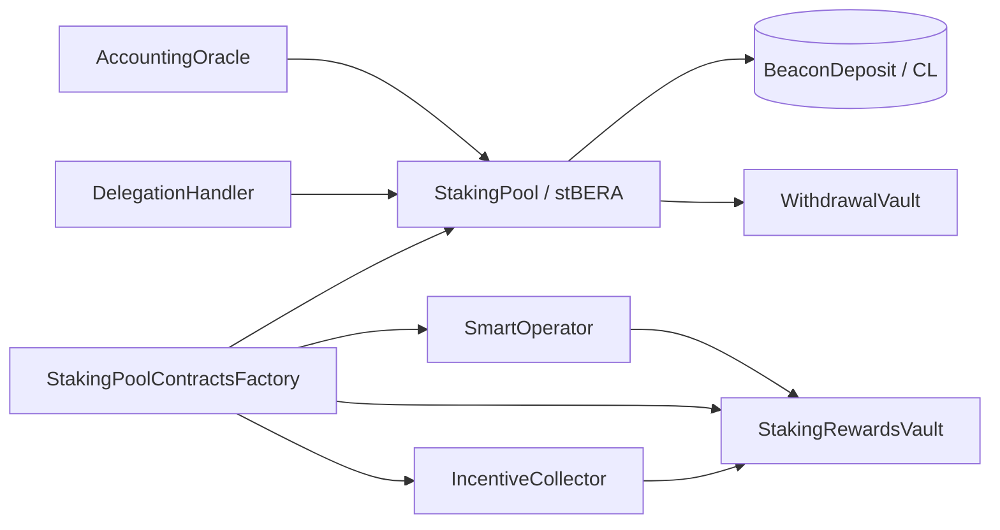

# Berachain Staking Pool Contracts

Solidity contracts for Berachain **validator staking pools**: liquid staking via **stBERA**, per-validator operator tooling, delegation, and withdrawal handling. Built with [Foundry](https://book.getfoundry.sh/).

Depends on [berachain/contracts](https://github.com/berachain/contracts) (`lib/contracts`) for POL interfaces (BeaconDeposit, BGT, BeraChef, etc.).

## Architecture

Each validator launched through the factory gets a **core contract set** (beacon proxies, upgradeable by governance):

| Contract | Role |
|----------|------|
| `StakingPoolContractsFactory` | Deploys per-validator contracts; validates CL proofs (EIP-4788); owns implementation beacons |
| `StakingPool` | Accepts BERA deposits; mints **stBERA** shares; routes funds to the consensus layer |
| `SmartOperator` | Validator admin surface: BGT boost/unboost, reward allocation, commission, protocol fees |
| `StakingRewardsVault` | Holds execution-layer rewards before distribution to the pool |
| `IncentiveCollector` | Collects and forwards validator incentives to the rewards vault |
| `WithdrawalVault` | Temporary withdrawal custody; ERC-721 withdrawal request NFTs |
| `AccountingOracle` | Feeds CL balance proofs into pool `totalDeposits` accounting |
| `DelegationHandler` | Delegated staking: operators accept third-party BERA under role-gated rules |



Deployed addresses are in [`script/StakingPoolAddresses.sol`](script/StakingPoolAddresses.sol).

## Repository layout

```
src/
  core/           StakingPool, SmartOperator, StakingRewardsVault, IncentiveCollector
  delegation/     DelegationHandler, DelegationHandlerFactory
  base/           StBERA share accounting, Create2 deploy helpers
  helpers/        Beacon roots (EIP-4788), execution-layer withdrawal helpers
  interfaces/     Public interfaces
script/
  deploy/         Ordered deployment scripts (implementations → core → ownership transfer)
  base/           Chain config, RBAC, address book, storage
test/             Unit and integration tests
```

## Development

### Prerequisites

- [Foundry](https://book.getfoundry.sh/getting-started/installation)
- Git submodules initialized (`git clone --recurse-submodules …`)

### Setup

```sh
git clone --recurse-submodules https://github.com/berachain/contracts-staking-pools.git
cd contracts-staking-pools
forge build
```

### Test

```sh
forge test
```

CI runs `forge fmt --check`, `forge build --sizes`, and `forge test -vvv`.

### Format

```sh
forge fmt
```

### Deploy

Deployment is scripted and chain-aware. See `script/deploy/`:

1. `0_DeployCoreContractsImplementations.s.sol` — implementation contracts
2. `1_DeployContracts.s.sol` — factory, oracle, withdrawal vault
3. `2_TransferOwnership.s.sol` — hand off to governance
4. `3_DeployDelegationHandler.s.sol` — delegation factory (when needed)

Predict CREATE2 addresses before deploy:

```sh
forge script script/PredictAddresses.s.sol --rpc-url <rpc>
```

Example (local Anvil):

```sh
forge script script/deploy/1_DeployContracts.s.sol:DeployStakingPoolContractsFactoryScript \
  --rpc-url http://127.0.0.1:8545 \
  --broadcast
```

RPC endpoints and explorer config are in [`foundry.toml`](foundry.toml).

## Related repos

- [berachain/contracts](https://github.com/berachain/contracts) — core POL / system contracts (submodule)
- [berachain/docs](https://github.com/berachain/docs) — public documentation
